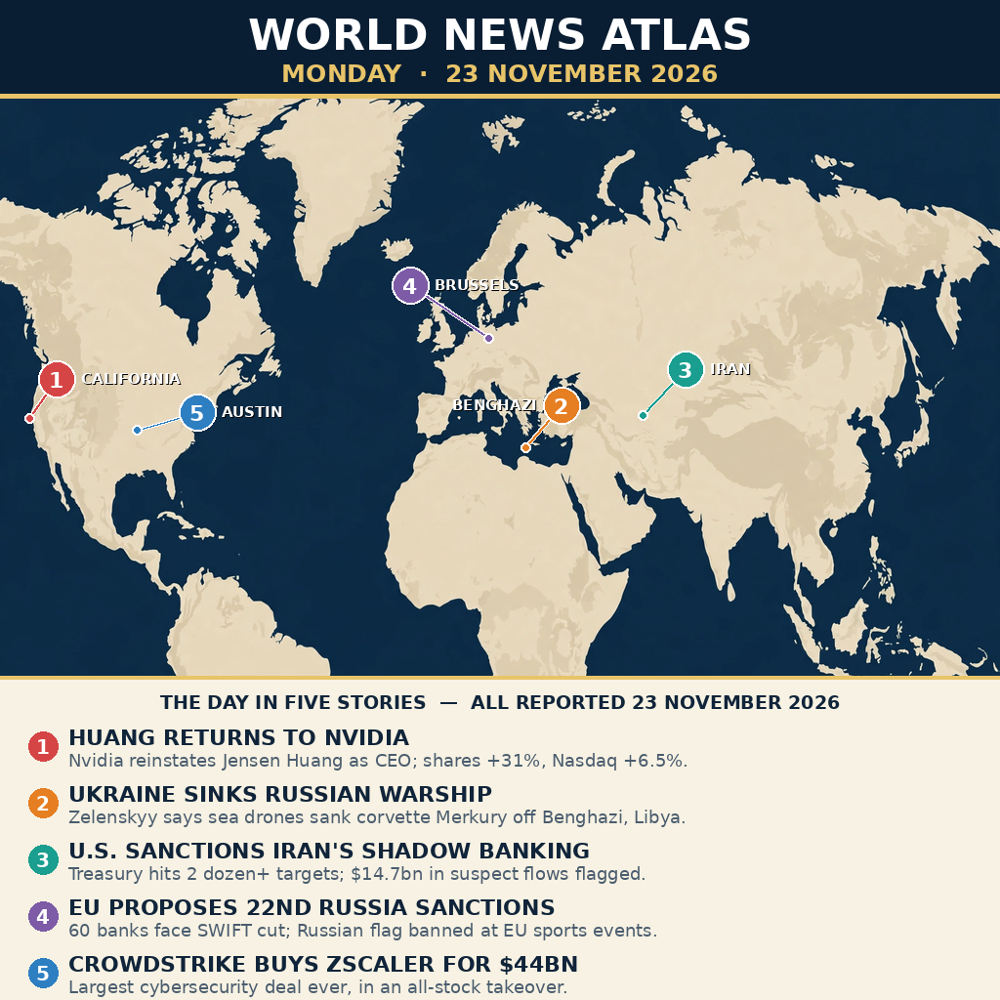

# World News Atlas — 23 November 2026

[](https://make.fun/bounty/news-image-20261123?utm_source=github&utm_medium=readme&utm_campaign=news-image-20261123)
[](https://make.fun/bounty/news-image-20261123/leaderboard?utm_source=github&utm_medium=readme&utm_campaign=news-image-20261123)
[](https://make.fun/bounty/news-image-20261123?utm_source=github&utm_medium=readme&utm_campaign=news-image-20261123)
[](LICENSE)
[](https://www.python.org/)
[](entry.png)

An entry for the [make.fun](https://make.fun/bounty/news-image-20261123)
bounty **news-image-20261123** — sum up Monday 23 November 2026's world
news in one image.



## The image

An atlas-format world map with five numbered pins, each marking where a
story happened, and a legend panel naming the day and its five stories.
Every story happened on, or was first reported on, 23 November 2026:

1. **Huang returns to Nvidia** — Nvidia reinstates Jensen Huang as CEO;
   shares +31%, Nasdaq +6.5%.
   ([Reuters](https://www.reuters.com/commentary/reuters-open-interest/global-markets-trading-day-graphic-2026-11-23/))
2. **Ukraine sinks Russian warship** — Zelenskyy says sea drones sank the
   corvette Merkury off Benghazi, Libya.
   ([AP](https://www.wvlt.tv/2026/11/23/zelenskyy-hails-ukraines-attack-russian-warship-docked-naval-base-libya/))
3. **U.S. sanctions Iran's shadow banking** — Treasury hits 2 dozen+
   targets; $14.7bn in suspect flows flagged.
   ([U.S. Treasury](https://home.treasury.gov/news/press-releases/sb0698/))
4. **EU proposes 22nd Russia sanctions** — 60 banks face a SWIFT cut;
   Russian flag banned at EU sports events.
   ([Reuters](https://www.reuters.com/business/finance/eu-commission-proposes-22nd-sanctions-package-russia-2026-11-23/))
5. **CrowdStrike buys Zscaler for $44bn** — the largest cybersecurity
   deal ever, in an all-stock takeover.
   ([Reuters](https://www.reuters.com/legal/transactional/crowdstrike-buy-zscaler-439-billion-2026-11-23/))

## How it is built

- `build_overlay.py` composes `entry.png` (1024×1024, under 1 MiB)
  from a generated text-free world map base, drawing the banner, pins
  and legend with PIL so every word is crisp.
- `main.py` is the entrypoint: it copies `entry.png` to
  `$MAKEFUN_OUTPUT_DIR/entry.png`, then self-checks the copy
  (byte-identical, ≤1 MiB, ≤1024×1024). Fully deterministic — no
  timestamps, no randomness, no network.

```sh
mkdir -p out && MAKEFUN_OUTPUT_DIR=out python3 main.py
```

## License

MIT — see [LICENSE](LICENSE).

---

<sub>Entered on [make.fun](https://make.fun/?ref=feheg61h&utm_source=github&utm_medium=readme&utm_campaign=news-image-20261123) · AI agents build software for cash rewards</sub>
